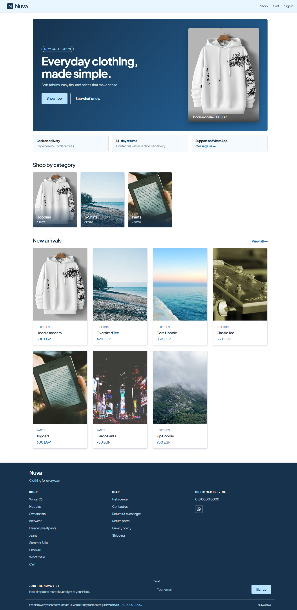
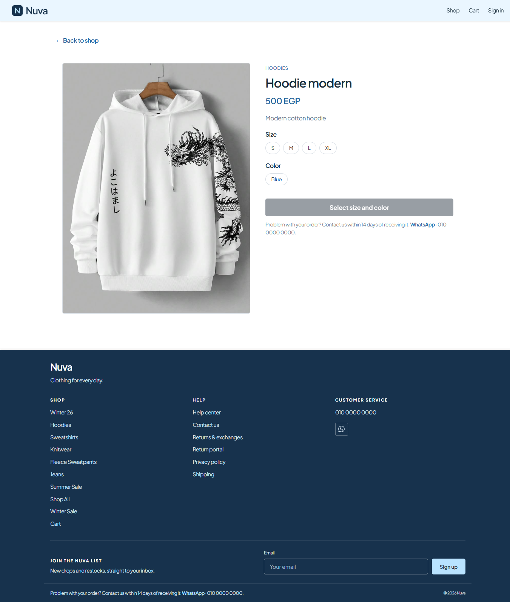
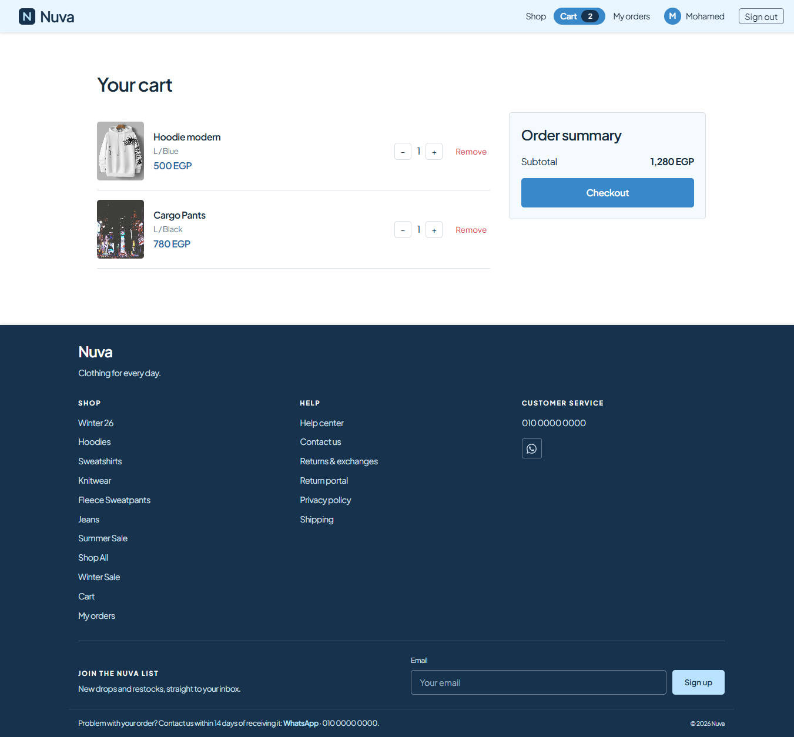
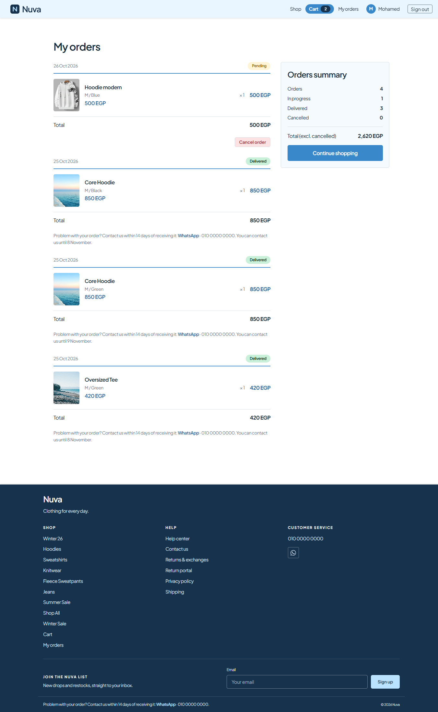
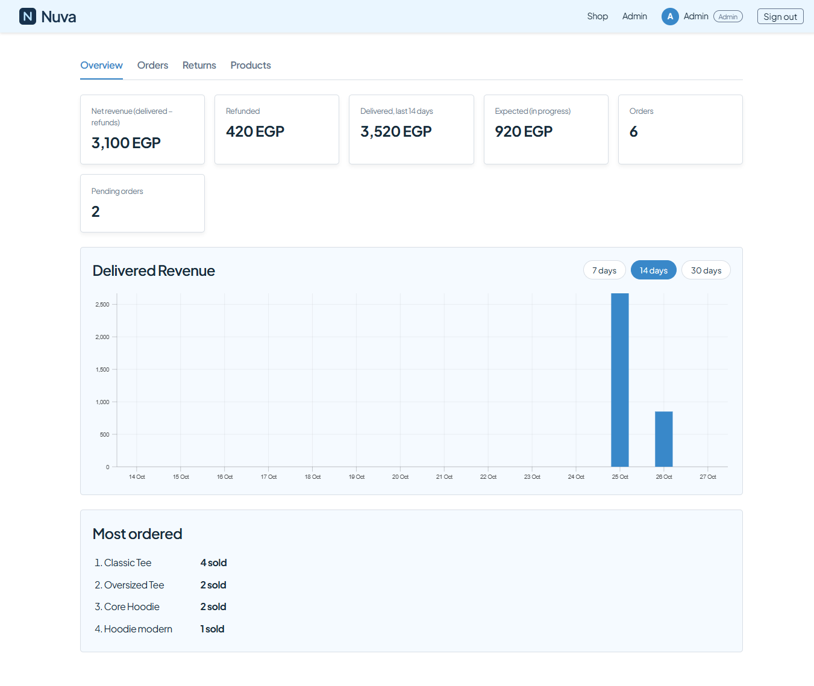
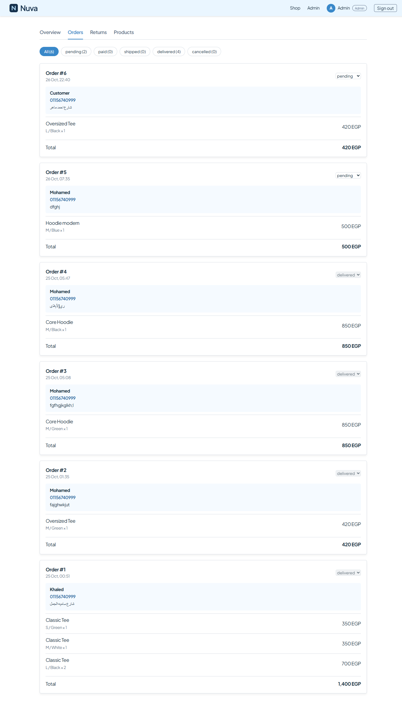
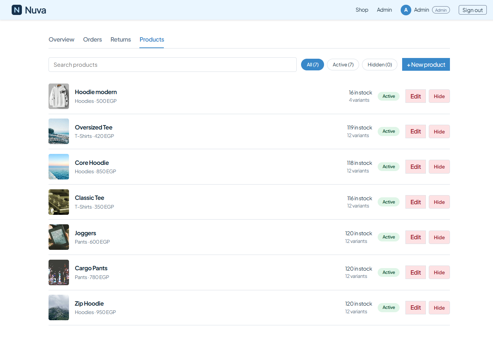
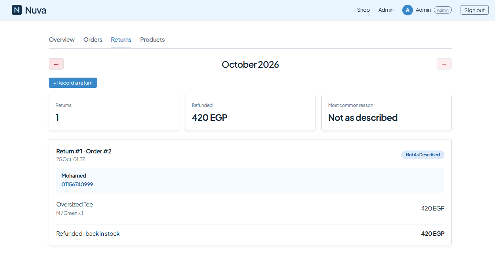

# Nuva — Clothing Store

A full-stack e-commerce store with a customer storefront and an admin dashboard, built with **React 19** and **Supabase**.

Customers browse products, pick size and color variants, order with cash on delivery, and track or cancel their orders. Admins manage products, stock, orders and returns, and watch a live sales dashboard.

**Live demo:** https://nuva-six.vercel.app/



## Demo accounts

| Role     | Email                | Password         |
| -------- | -------------------- | ---------------- |
| Customer | customer@example.com | `Customer_12345` |
| Admin    | Available on request |                  |

You can also create your own customer account from the Sign up page.

## Screenshots

| Product page                             | Cart                               | My orders                              |
| ---------------------------------------- | ---------------------------------- | -------------------------------------- |
|  |  |  |

| Admin dashboard                                    | Admin orders                                       | Admin products                                         |
| -------------------------------------------------- | -------------------------------------------------- | ------------------------------------------------------ |
|  |  |  |

| Returns report                                 | Mobile                                 |
| ---------------------------------------------- | -------------------------------------- |
|  |  |

## Features

### Storefront

- Home page with a hero, category tiles and new arrivals
- Shop with category filtering (the filter lives in the URL, so it can be shared and survives a refresh)
- Product page with size and color variants, live stock, unavailable combinations disabled, and low-stock warnings
- Cart that follows the account: signed-in users' carts are stored in Supabase and sync across devices; a guest cart lives in the browser and is merged into the account on sign in
- Checkout with cash on delivery, where price and stock are validated on the server
- My orders with status badges, cancellation of pending orders, and a return window shown per delivered order
- Responsive layout with a mobile menu, a 404 page and an error page

### Admin

- Realtime dashboard: net revenue (delivered minus refunds), revenue per day over 7, 14 or 30 days, expected revenue, most ordered products, and pending orders
- Orders management: filter by status, change status through a database function, delivered and cancelled orders are final, and cancelling restores stock
- Returns: record a return against a delivered order, choose whether to restock, and browse a report for each calendar month
- Product management: search, hide or show, create and edit with image upload to Supabase Storage, per-variant stock editing, and inline category creation

## Engineering highlights

- **Row Level Security on every table.** Customers can only read their own orders and cart. The catalog is public to read and writable by admins only.
- **Business logic lives in Postgres functions (RPC).** `create_order` recalculates prices and totals in the database, locks stock rows with `FOR UPDATE`, and runs everything in one transaction. A tampered cart cannot change a price or oversell an item.
- **Roles cannot be self-assigned.** New accounts are always customers, and admin actions are verified inside the database with `is_admin()`, not just hidden in the UI.
- **Optimistic concurrency on stock edits.** If an order comes in while an admin is editing, the save is rejected instead of overwriting the new stock.
- **Storage policies.** Only admins can upload or delete product images, and the bucket accepts JPG, PNG and WebP up to 2 MB.
- **Code splitting.** Admin routes are lazy-loaded and the React and Supabase libraries get their own chunks. A visitor's first load is about 537 kB of JavaScript (158 kB gzipped), and the admin dashboard with its charts (127 kB) is only downloaded by admins.
- **Accessibility basics.** Semantic HTML, ARIA labels and live regions for status messages, and visible keyboard focus.

## Tech stack

React 19 · Vite 6 · React Router 7 · Supabase (Postgres, Auth, Realtime, Storage) · react-charts · Vercel

## Data model

| Table                                        | Purpose                                                                |
| -------------------------------------------- | ---------------------------------------------------------------------- |
| `user_profiles`                              | Name and role (`customer` or `admin`), created by a trigger on sign up |
| `categories`, `products`, `product_variants` | Catalog. Stock is tracked per variant (size and color)                 |
| `cart_items`                                 | Carts of signed-in users                                               |
| `orders`, `order_items`                      | Orders. Each item keeps the unit price paid at purchase time           |
| `product_returns`, `product_return_items`    | Recorded returns with the refunded amount                              |

| Function                                               | What it does                                                                   |
| ------------------------------------------------------ | ------------------------------------------------------------------------------ |
| `create_order(items, address, phone)`                  | Validates the cart, locks and decrements stock, computes totals                |
| `cancel_order(order_id)`                               | Lets a customer cancel their own pending order and restores stock              |
| `admin_set_order_status(order_id, status)`             | Validated status transitions, sets the delivery date, restores stock on cancel |
| `admin_sales_stats(days)`                              | Dashboard numbers, calculated in the Cairo time zone                           |
| `admin_save_product(...)`                              | Atomic product and variants save with a stock concurrency check                |
| `admin_record_return(...)`, `admin_returns_month(...)` | Record a return and build the monthly report                                   |
| `is_admin()`                                           | Helper used by the RLS policies                                                |

The complete definitions live in [`supabase/sql/`](supabase/sql), so the whole backend can be recreated in a new Supabase project (see [Set up the database](#set-up-the-database)).

## Getting started

**Requirements:** Node.js 18 or later and a free [Supabase](https://supabase.com) project.

```bash
git clone https://github.com/AhmadMetwally711/Nuva.git
cd Nuva
npm install
Copy-Item .env.example .env
```

Fill in `.env` with your project values (Project Settings, API):

```
VITE_SUPABASE_URL=https://YOUR-PROJECT.supabase.co
VITE_SUPABASE_KEY=YOUR-ANON-KEY
```

Use the `anon` public key only. Never put the `service_role` key in the frontend or in the repository.

### Set up the database

1. Open the Supabase SQL Editor and run the files in `supabase/sql/` in numeric order. Every file can be run more than once.

   | File                        | What it does                                                                                                  |
   | --------------------------- | ------------------------------------------------------------------------------------------------------------- |
   | `01_schema.sql`             | Tables, constraints and foreign keys. Row Level Security is switched on for every table                       |
   | `02_functions_triggers.sql` | `is_admin()`, the sign-up trigger, and the order and admin functions                                          |
   | `03_rls.sql`                | Row Level Security policies                                                                                   |
   | `04_storage.sql`            | The public `product-images` bucket (JPG, PNG, WebP, up to 2 MB) and its admin-only upload and delete policies |

   The tables start empty. Once you are an admin (next step), add categories and products from the admin dashboard.

2. Create your own account from the app's Sign up page, then promote it to admin by running this in the SQL Editor:

```sql
update user_profiles
set account_type = 'admin'
where id = (select id from auth.users where email = 'you@example.com');
```

3. Start the app:

```bash
npm run dev
```

### Scripts

| Command           | Description                           |
| ----------------- | ------------------------------------- |
| `npm run dev`     | Start the development server          |
| `npm run build`   | Create the production build in `dist` |
| `npm run preview` | Serve the production build locally    |
| `npm run lint`    | Run ESLint                            |

## Deployment

The app is deployed on Vercel.

1. Import the repository in Vercel. The Vite preset is detected automatically.
2. Add `VITE_SUPABASE_URL` and `VITE_SUPABASE_KEY` as environment variables, then deploy.
3. `vercel.json` rewrites every route to `index.html`, so deep links such as `/shop` or `/orders` keep working after a refresh.
4. In Supabase, open Authentication, URL Configuration, and set the Site URL and Redirect URLs to the deployed address.
5. For the public demo, email confirmation is turned off in Authentication, so new accounts can sign in right away.

## Project structure

```
src/
├─ components/     layouts, header, footer, cards, route guards
├─ context/        AuthContext and CartContext
├─ routes/         storefront and admin pages
├─ config.js       contact details and the return window
├─ returnReasons.js
├─ sizes.js
└─ supabase-client.js
supabase/sql/      schema, functions, policies, storage (run in numeric order)
public/            favicon
```

## Design decisions

- **Hide instead of delete.** Orders reference product variants, so products are hidden rather than removed. Order history always stays intact.
- **The database decides, the browser asks.** Prices, totals, stock changes and roles are never trusted from the client.
- **Returns are recorded by the admin.** Customers contact the store within 14 days of delivery, which matches how many small shops work, and the admin records the return so refunds and stock stay consistent.
- **Cart stored per account.** Moving the cart to the database means prices and stock shown in the cart are always current.

## Known Limitations and Future Improvements

- Cash on delivery is currently the only supported payment method. Online payments are planned for a future release.
- Wishlist, email notifications, and return request functionality are not implemented yet.
- Automated testing is planned, including Vitest for unit tests and Playwright for end-to-end testing.
- The live demo may take longer to load after periods of inactivity due to Supabase free-tier project pausing.

## Author

**Ahmad Metwally** · [LinkedIn](https://www.linkedin.com/in/ahmad-metwally-8007b9407/) · [GitHub](https://github.com/AhmadMetwally711) · ahhmadsalehh@gmail.com
